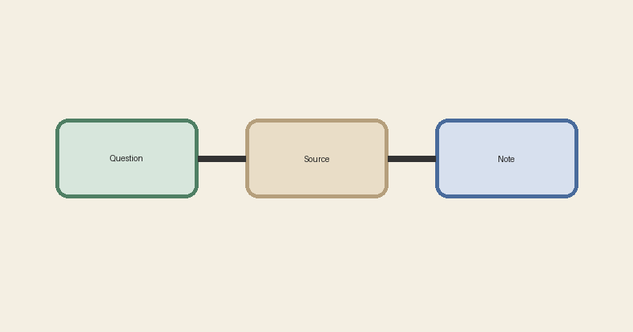

<!-- sr:page 1 -->

# أصول القراءة البحثية

**المؤلف:** فريق اختبار القارئ الذكي

هذا كتاب اختبار صغير للتحقق من أن القارئ يعرض العربية من اليمين إلى اليسار، ويحفظ بنية النص عند الاستيراد.

## الفصل الأول القراءة المقصودة

### معنى القراءة المقصودة

ليست القراءة جمعاً للنصوص فحسب، بل هي فهم السياق وتسجيل الفائدة والقدرة على الرجوع إلى المصدر عند الحاجة.[^method]

الجملة المتكررة للاختبار هي: **الرجوع إلى المصدر يحفظ سياق الفائدة**.

للمزيد انظر [دليل المنهج](https://example.org/manhaj).

1. حدّد السؤال قبل البدء.
2. اقرأ المقطع في سياقه.
3. دوّن الفائدة مع موضعها.

- يمكن أن تكون الملاحظة قصيرة.
- ويمكن أن تتحول إلى بحث مستقل.

<!-- sr:page 2 -->

شكل ١: مخطط مسار الملاحظة.

| العنصر | الغرض | مثال |
| --- | --- | --- |
| السؤال | تحديد المقصود | ما معنى الوقت؟ |
| المصدر | مراجعة الدليل | كتاب، فصل، فقرة |
| الملاحظة | حفظ النتيجة | رابط إلى المقطع |

## الفصل الثاني التوثيق والعودة

### لماذا نحتاج إلى رابط ثابت

الجملة المتكررة للاختبار هي: **الرجوع إلى المصدر يحفظ سياق الفائدة**.

إذا كانت العبارة متشابهة في موضعين، فلا يكفي البحث عن الكلمات وحدها؛ بل يحتاج النظام إلى هوية ثابتة للمقطع.[^identity]

#### مثال في الأرقام

في سنة 2026 راجع الباحث 12 مصدراً، ثم أضاف الرقم العربي ١٢ إلى ملاحظاته للمقارنة بين أنماط الأرقام.

> الملاحظة البحثية الجيدة لا تنفصل عن موضعها في الكتاب.

<!-- sr:page 3 -->

## الفصل الثالث بناء الملاحظة

### من القراءة إلى البحث

بعد قراءة المقطع، اكتب الفكرة بلغتك، ثم أضف النص المنقول ورابطه إلى المصدر. لا يكفي أن تتذكر العبارة؛ يجب أن تستطيع العودة إليها.

الجملة المتكررة للاختبار هي: **الرجوع إلى المصدر يحفظ سياق الفائدة**.

| الخطوة | العمل |
| --- | --- |
| ١ | تحديد السؤال |
| ٢ | قراءة السياق |
| ٣ | كتابة الملاحظة |

هذه صفحة ثالثة فعلية في مصدر الاختبار، وليست مجرد زيادة في طول الصفحة الأولى.

[^method]: الحاشية الأولى: المقصود بالمنهج هنا ترتيب القراءة والسؤال والتوثيق.
[^identity]: الحاشية الثانية: هوية المقطع معرف داخلي ثابت، وليست عنوان الفصل وحده.
